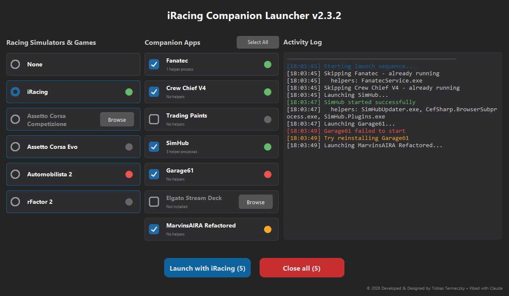

# iRacing Companion Launcher

A Windows app that starts your sim-racing companion apps and your racing sim with one click, and closes the apps again when you are done. It finds the apps by itself, shows which ones are running and how many helper processes each has started, and keeps a log of what it did.



## Install

Download `iRacing_Companion_Launcher_Setup.exe` from the [latest release](https://github.com/yzaazy/iRacing-Companion-Launcher/releases/latest) and run it. Upgrading from 2.x replaces the old version and keeps your settings.

## Supported apps and games

| Companion apps | Racing games |
|---|---|
| Fanatec | iRacing |
| Crew Chief V4 | Assetto Corsa Competizione |
| Trading Paints | Assetto Corsa Evo |
| SimHub | Automobilista 2 |
| Garage61 | rFactor 2 |
| Elgato Stream Deck | |
| MarvinsAIRA Refactored (Marvin's Awesome iRacing App) | |

## How it finds them

- **Apps**: the path you saved before, then a shortcut in the Start Menu (yours, then the one for all users), then the usual install folders.
- **Games**: the path you saved before, then the Steam install registry (the game is launched through Steam).
- **Not found**: the card says "Not installed" and shows a **Browse** button. Pick the app's exe (or a shortcut, for games) and the launcher remembers it.

A path that is found is saved, so the next start is quick.

## Launch and Close

- **Launch** starts every checked app that is not already running, then the selected game (or none). Each card shows Starting, then Running or Failed.
- **Close** closes every checked app. For an app the launcher started, it closes the whole process tree that app started, helpers included; this also works after the launcher was restarted. An app started some other way is closed by its exe name.
- The game is never closed by the launcher. Close tells you in the log if it is still running.
- Pressing a button while a sequence runs queues it; it runs when the current one finishes.

## Keyboard

Nothing is focused when the window opens, so a stray key does nothing. **Tab** and **Shift+Tab** move a visible focus ring through the controls; **Space** or **Enter** activates the focused one; **Escape** or a mouse click drops the focus. When the log is focused, the arrow keys, Page Up/Down, Home and End scroll it.

## Settings

Stored in `%APPDATA%\iRacingCompanionLauncher\`:

- `config.ini`: saved paths, which apps are checked, the selected game.
- `process_state.json`: the apps the launcher started, so Close can find their processes after a restart.

Both files are shared with 2.x. Delete them to start fresh.

## Development

Requirements: Windows, Rust through [rustup](https://rustup.rs) (the toolchain is pinned in `rust-toolchain.toml` and installed on first use), and [Inno Setup 6](https://jrsoftware.org/isinfo.php) only to build the installer.

```powershell
cargo run                    # debug build; config and state go to target/dev-config/
pwsh tools/gate.ps1          # format, clippy (warnings as errors), tests: must end with GATE GREEN
cargo build --release        # target\release\iracing-companion-launcher.exe
```

The release exe is one self-contained file; its version comes from `Cargo.toml`. `windows installer.iss` packages it into `installer_output\iRacing_Companion_Launcher_Setup.exe`. Tests launch and kill only dummy processes they start themselves.

Further reading:

- [docs/architecture.md](docs/architecture.md): how the program is built and tested
- [docs/behaviour.md](docs/behaviour.md): what it does in detail, and what changed from 2.x
- [docs/adr/](docs/adr/README.md): architecture decisions

## License

MIT, see [LICENSE](LICENSE).
