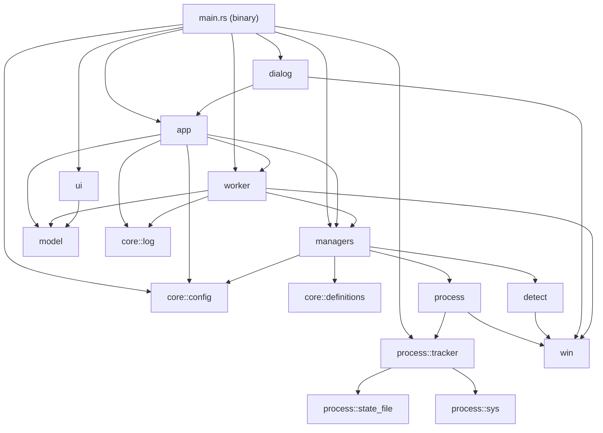
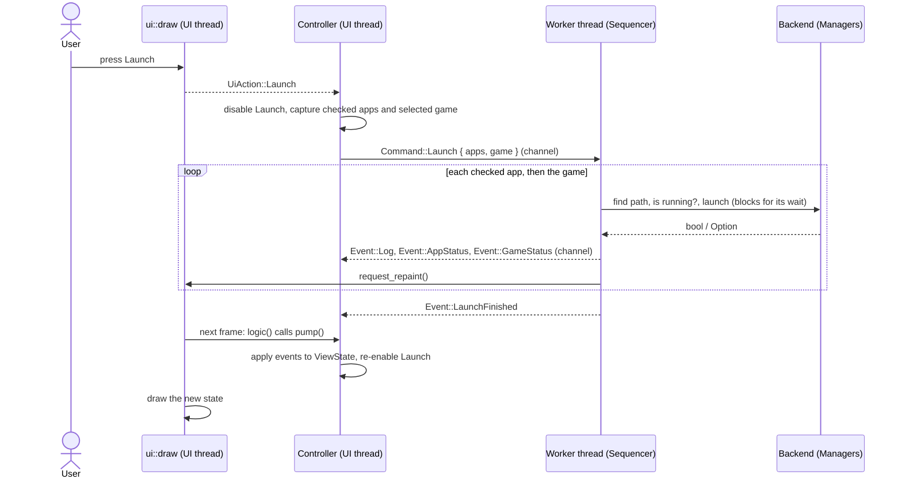

# Architecture

How the launcher is built, for someone about to change it. What the program does, rule by rule, is in [behaviour.md](behaviour.md); why it is built this way is in the [ADRs](adr/README.md).

## Crate

One package at the repo root, `iracing-companion-launcher`, edition 2024, with a library (`src/lib.rs`, which declares every module) and a thin binary (`src/main.rs`). The binary resolves the config directory, runs startup, opens the window and calls the UI each frame; everything else is in the library, so the integration tests under `tests/` drive the same code the exe runs ([ADR 0002](adr/0002-one-package-library-and-binary.md)).

- Pinned in `Cargo.toml`: eframe, egui and egui_kittest 0.37, `windows` 0.62. The toolchain is pinned in `rust-toolchain.toml`.
- Dependencies: `eframe`/`egui` (UI), `windows` (every Win32 call), `raw-window-handle` (the dialog's owner window), `serde` + `serde_json`. Build: `winresource`. Dev: `egui_kittest`, `image`, `proptest`, `tempfile`.
- The module named `core` is always written `crate::core::...`, never bare `core::...`, so it shadows nothing.
- Release builds use `windows_subsystem = "windows"` (no console) and `panic = "abort"`.
- Visibility: an item is `pub` only when `main.rs` or a test uses it; the `unreachable_pub` lint keeps everything else `pub(crate)` or narrower. An item public only for tests says so in its doc comment.
- Lints are in `[lints]` of `Cargo.toml`; the gate denies their warnings. Fix a hit in code. Test code may `unwrap`/`expect` (`clippy.toml`); an integration-test file whose helpers need it carries a file-level `#![allow(clippy::unwrap_used, clippy::expect_used)]` with its reason.

## Module map



| Module | Owns |
|---|---|
| `main.rs` | Startup order, the eframe window (1200x700, fixed size, icon from `iRCL.ico`), the per-frame loop: `logic` pumps worker events, `ui` draws and hands actions to the controller. |
| `model` | What the screen shows and what the user did: `Status`, `LogLevel`, `LogLine`, `AppCard`, `GameCard`, `ViewState`, `UiAction`. |
| `app` | `Controller`: owns the `ViewState`, handles each `UiAction`, applies worker `Event`s, runs the startup checks, Browse validation, button and Select All rules. Seams: `Settings`, `FileDialog`. No Win32 code. |
| `worker` | `Command` and `Event`; `Sequencer` (the launch and close sequences); `Worker` (runs it on a thread); `Inline` (runs it on the caller's thread, for tests); the `Dispatch` trait. |
| `managers` | `Backend` trait and `Managers`, its real implementation: detection order, saving detected paths, launch and close per app, game launch routing. `TestHost` swaps in a fake Start Menu, Steam key, shell and waits for tests. |
| `dialog` | `NativeDialog`: the Windows open dialog (`IFileOpenDialog`) with Tk 8.6's options. |
| `core::config` | `ConfigStore` (hand-written `configparser`-compatible INI reader and writer), `SharedConfig`, `SetPathError`, `config_key`, `resolve_config_dir`. |
| `core::definitions` | The companion apps and racing games: `AppDef`, `GameDef`. |
| `core::log` | Log line construction: timestamp prefix, divider. |
| `detect::shortcuts` | Start Menu search and `.lnk` resolution through `IShellLinkW`. |
| `detect::steam` | Steam uninstall-key check. |
| `detect::paths` | First existing path in a list. |
| `process` | Name-based checks, kills, detached launch, `shell_open`. |
| `process::tracker` | `ProcessTracker`: launch and track by PID and creation time, tree walk, tracked close. |
| `process::state_file` | Reading and writing `process_state.json` in Python's exact byte format. |
| `process::sys` | Win32 primitives that copy what psutil does: snapshots, creation time (with the `NtQuerySystemInformation` fallback), open, wait, terminate, detached spawn. |
| `ui` | The window: `draw` and `install_fonts` (see [UI](#ui)). |
| `win` | Crate-private Windows helpers: UTF-16 strings, `ntpath.basename`, the COM apartment guard, RAII wrappers for handles, find handles and registry keys. |

## The three seams

The tests replace each side of three boundaries.

1. **`ui::draw(ui: &mut egui::Ui, state: &ViewState) -> Vec<UiAction>`.** A pure function of the view state. The UI keeps only hover, focus, scroll position, the log selection and the button flash; labels and enabled flags arrive computed. UI tests feed fixture states and synthetic input and read the actions and the pixels.
2. **The controller's traits.** `Settings` (the config calls the controller makes; implemented by `SharedConfig`), `FileDialog` (Browse; implemented by `NativeDialog`), and `Dispatch` (where commands go and events come from; `Worker` in the app, `Inline` in tests). Controller tests record and replay transcripts without a window, a thread or a real file.
3. **The worker's `Backend` trait.** Everything a sequence or the startup check asks of the machine. `Managers` is the real one; `tests/app_support` has a scripted fake that never touches a process.

One Launch press, from click to log lines:



## Threads

- **UI thread**: eframe's event loop. Owns the `Controller` and its `ViewState`. Startup (detection, running checks, the startup log) runs here before the window opens.
- **Worker thread**: started by `Worker::spawn` once the window exists, inside a COM apartment. It owns the `Managers` (and so the `ProcessTracker`) and runs one `Command` at a time, in the order sent. Waits (2 s after a launch, 3 s after a Steam launch, up to 3 s during a close) block only this thread.
- **What crosses**: `Command` goes UI → worker over an `mpsc` channel; `Event` goes worker → UI over another. The config is the only shared state: `SharedConfig` is an `Arc<Mutex<ConfigStore>>` used by the controller and the managers; its lock tolerates poisoning.
- **Waking the UI**: after each event the worker calls the `notify` closure given to `Worker::spawn`, which is `egui::Context::request_repaint`. The next frame's `logic` calls `Controller::pump`, which drains the channel.
- A button stays disabled while a command of its kind is queued or running (`ButtonState` in `app.rs`). Dropping the `Worker` ends the thread after its current sequence; the process exiting first ends it mid-sequence.
- No async runtime ([ADR 0003](adr/0003-one-worker-thread-no-async.md)).

## Process layer

- **Launch routes.** Apps: `LaunchMethod::Direct` (`CreateProcessW`, detached, new process group, only a `NUL` handle inherited; the PID comes back from the call) or `LaunchMethod::Shell` for apps whose definition sets `needs_shell_launch` (Stream Deck: `ShellExecuteW`, then the new PID is found by exe name). Games: `steam://` and `.lnk` through `shell_open`, an `.exe` through `launch_process` (detached, untracked).
- **Tracking.** `ProcessTracker` keeps, per app name, the root PID, its creation time and the exe path, and saves them to `process_state.json` at every change. An entry is valid only while that PID is alive with the same creation time (0.5 s tolerance), so a recycled PID is never acted on.
- **Tree walk.** One ToolHelp snapshot of (pid, parent pid, name); descendants of the root that were created at or after it, stopping at any process with a game's exe name (`ProcessTracker::spare`, set by `Managers`). The helper count on a card and the helper names in the log come from this walk.
- **Close.** Terminate root and descendants, wait up to 3 s, kill survivors, drop the entry. Untracked apps are killed by exe name. Games are never closed.

The exact rules are in [behaviour.md](behaviour.md#process-tracking).

## Detection

`Managers::find_app_path`: saved path (only if it exists on disk), Start Menu shortcut (`detect::shortcuts`, user then all-users Start Menu), common install paths (`detect::paths`). `find_game_path`: saved path, then the Steam uninstall key (`detect::steam`), which yields `steam://rungameid/<appid>`. Detection functions are synchronous and write nothing; the manager saves a detected path to `config.ini`. Not found means the card offers Browse. Details in [behaviour.md](behaviour.md#detection).

## UI

The UI paints everything itself with egui's painter instead of using egui's widgets, so that it can match the v2.3.2 window pixel for pixel ([ADR 0001](adr/0001-rust-egui-pixel-parity.md)).

- **Layout is rules, not coordinates.** `ui::pack` is a port of Tk's pack geometry manager (`tkPack.c`); `ui::layout` describes each container as the list of widgets v2.3.2 packed into it, with the same options, and places them with the packer. `ui::geometry::geometry(ctx, state, window)` adds the parts that depend on measured text (label widths, buttons growing with their label, a long name squeezing its Browse button, the log scrollbar) and resolves the whole window. `ui::sections` paints exactly that geometry, and the layout test reads the same geometry. Because the rules are evaluated for a window size, the window can become resizable later.
- **Theme.** Every colour, corner radius, border width and font size is a constant in `ui::theme`, taken from v2.3.2's constants and CustomTkinter's dark blue theme. Widgets and sections hold no numbers of their own.
- **Widgets.** `ui::widgets` paints CustomTkinter's shapes: rounded frames, checkbox, radio, status dot, buttons with hover, disabled and pressed-flash states.
- **Input and focus.** `ui::input` keeps its own focus and hit-testing: controls act on the press, hit areas are exact (egui's 5 px interact radius is set to 0), and egui's own focus is not used, so egui's Tab handling and Space/Enter clicks never reach the controls. Keyboard rules are in [behaviour.md](behaviour.md#changes-from-v232).
- **Log.** `ui::log` is its own read-only text view: wrap by character, scroll to the end on every new line, 40 px per wheel notch, scrollbar only when needed, selection with mouse and keyboard, copy. The log is unbounded, so a frame lays out only the lines in view and finds the first by binary search; `tests/ui/log_perf.rs` guards that the cost per frame does not grow with length.
- **Text.** `ui::text` lays text out as GDI does: each glyph advance rounded to whole device pixels, no kerning. egui's default shaping would make strings a few pixels narrower or wider.
- **Fonts.** `ui::fonts` reads Segoe UI (regular and bold) and Consolas from `%WINDIR%\Fonts` at startup. A character those lack is resolved on first use: Windows' font-link list for Segoe UI (`HKLM\...\FontLink\SystemLink`), then a list of Windows fonts for other scripts, then egui's bundled fonts. A candidate's character map is read to decide; the whole file only when it has the character. `ui::fonts::cmap` is the minimal OpenType reader for that.

### Why some numbers are odd

`tests/fixtures/ui/ui-spec.json` was measured from the running v2.3.2 window. It is about 500 KB: read its `_readme`, `notes`, `layout`, `shapes`, `fonts` and `colors` keys, and query `states` with a short script rather than loading it whole. The measured window differs from the declared sizes in ways the rules reproduce:

- The sections request 713 px of height in a 700 px window. Tk allocates in packing order, so the button row, packed last, absorbs the 13 px: the action buttons are 47 px tall (46 painted) at y 610–656, and nothing else moves.
- CustomTkinter rounds painted sizes down to even numbers: cards paint 316x54, the log box 516x444, so the visible gap between cards is 11 px.
- Buttons grow with their label: Launch is 205 px wide for "Launch with iRacing (5)", and the row re-centres.
- A long app name squeezes its Browse button (57 px for MarvinsAIRA Refactored).
- Consolas 14 px lays out at 8 px per character and a 17 px line pitch: 62 characters per log line, 61 with the scrollbar.

## Config and state location

`core::config::resolve_config_dir`, in order:

1. `IRCL_CONFIG_DIR`, when set and non-empty.
2. Debug builds (`cargo run`, `cargo test`): `target/dev-config/` under the repo.
3. Release builds: `%APPDATA%\iRacingCompanionLauncher`, as v2.3.2 used, so an upgrade keeps its settings.
4. With `APPDATA` unset: the exe's directory.

The directory is created if missing. It holds `config.ini` and `process_state.json`; both formats are compatible with v2.3.2 in both directions ([ADR 0005](adr/0005-files-compatible-with-v2.md), formats in [behaviour.md](behaviour.md#config)). Tests always pass an explicit temp directory.

## Shared types

`src/model.rs` and the protocol in `src/worker.rs`. All derive `Debug, Clone, PartialEq, Eq` and serde with `snake_case` names, so a fixture file deserialises straight into `ViewState` and transcripts record events as JSON. `Status` and `LogLevel` are also `Copy, Hash` and passed by value.

```rust
pub enum Status { Idle, Starting, Running, Failed, Stopping, Stopped, NotFound }
pub enum LogLevel { Info, Success, Error, Warning, Launch, Close, Divider }

pub struct LogLine { pub level: LogLevel, pub text: String } // text is final, timestamp included
pub struct AppCard { pub name: String, pub status: Status, pub checked: bool, pub helper_count: usize }
pub struct GameCard { pub name: String, pub status: Status }

pub struct ViewState {
    pub version: String,
    pub apps: Vec<AppCard>,
    pub games: Vec<GameCard>,
    pub selected_game: Option<String>, // None is the "None" radio
    pub log: Vec<LogLine>,
    pub select_all_label: String,
    pub launch_label: String,
    pub close_label: String,
    pub launch_enabled: bool,
    pub close_enabled: bool,
}

pub enum UiAction {
    ToggleApp { name: String, checked: bool }, // the new value
    ToggleSelectAll,
    SelectGame(Option<String>),                // only for a radio not already selected
    BrowseApp(String),
    BrowseGame(String),
    Launch,
    Close,
}

// src/worker.rs
pub enum Command {
    Launch { apps: Vec<String>, game: Option<String> },
    Close { apps: Vec<String>, game: Option<String> },
}

pub enum Event {
    Log(LogLine),
    AppStatus { name: String, status: Status, helper_count: usize },
    GameStatus { name: String, status: Status },
    LaunchFinished,
    CloseFinished,
}
```

## Tests

`cargo test` runs everything; the gate (`pwsh tools/gate.ps1`) runs format, clippy with warnings as errors, and tests, and ends with `GATE GREEN` or `GATE RED: <step>`. `-Release` adds a release build and compiles the installer script into a temp directory (skipped, and said so, when Inno Setup is not installed). The gate holds a machine-wide named mutex (`tools/build-lock.ps1`), so gates from several worktrees run one at a time; other cargo commands take the same lock with `pwsh tools/build-lock.ps1 cargo ...`.

| Test binary | Covers |
|---|---|
| `core_config` | `ConfigStore` against files written by Python's `configparser` (`tests/fixtures/core/`): parse, interpolate, save byte for byte, Windows-1252 input. |
| `core_config_dir` | `resolve_config_dir` and `IRCL_CONFIG_DIR` (its own binary, because it sets an environment variable). |
| `core_definitions` | The definitions equal v2.3.2's, dumped to `tests/fixtures/core/definitions.json`. |
| `core_log` | Log line format. |
| `detect_paths`, `detect_shortcuts`, `detect_steam` | Common paths; Start Menu search over fake trees with real `.lnk` files, with v2.3.2's answers frozen in the test; the Steam check under a temporary `HKCU` key. |
| `process_layer` | Launch, track, tree walk, close and name matching against dummy processes; reading and rewriting state files written by v2.3.2 (`tests/fixtures/process/`) to the same bytes. |
| `app_managers` | The real `Managers` over dummy definitions and a `TestHost`: detection order and its config saves, tracked-then-by-name fallbacks, game launch routing. |
| `app_transcripts` | Golden transcripts recorded from the v2.3.2 controller (`tests/fixtures/app/transcripts.json`), replayed against `Controller` + `Sequencer` with the fake backend through `Inline`: same log lines, statuses, config writes and end state. |
| `app_worker` | The real worker thread with the fake backend: queueing, order, selection captured at the press, buttons disabled while pending. |
| `model_serde` | The shared types read the fixture shape and round-trip. |
| `properties` | Property tests: `ConfigStore::load` never panics, saving is stable, accepted values round-trip, the game-name wrap. More sit beside private code in `src/process/state_file.rs` and `src/process/sys.rs`. |
| `ui` (`tests/ui/main.rs`) | One binary: `layout` (geometry at 1200x700 equals `ui-spec.json` in every fixture state), `parity` and `parity_check` (pixels), `interaction`, `keyboard`, `log_gestures`, `log_perf`, `fonts`, `renders`. Renders share one wgpu device (`support`). |

Unit tests inside `src/` cover private code (the INI reader, the state file, the FILETIME conversion against psutil's, the dialog options, the window icon and zoom).

### Dummy processes

The developer's real companion apps run on the machine the tests run on. Every process a test launches, matches by name or kills is a copy of `tests/fixtures/process/dummy.rs`, compiled by the tests, under a unique `ircl-test-<random>-<role>.exe` name in a temp directory (`tests/dummy_support`). They are killed and deleted on drop, and exit by themselves after two minutes. The real definitions appear only in tests where nothing is detected, launched or closed.

### Pixel parity and golden renders

`tests/fixtures/ui/fixtures.json` holds five view states (`idle`, `mixed`, `none-selected`, `all-missing`, `log-full`); `tests/fixtures/ui/reference/<state>.png` are screenshots of v2.3.2 showing those states. They are fixed test data: there is no Python app left to recapture them. The fixtures carry `version` `2.3.2` and fixed timestamps to match.

`cargo test --test ui parity` renders each state in memory and

1. compares it with its reference in three classes (below), writing the render to `target/ui-snapshots/<state>.png` and, on failure, a diff image to `target/ui-diff/<state>.png`;
2. if parity passes, compares it with its golden render `tests/snapshots/<state>.png` at egui_kittest's per-pixel threshold 0.6 with no failing pixel; a failure writes `<state>.diff.png` and `<state>.new.png` beside it.

| Class | Covers | Passes when |
|---|---|---|
| flat | Every pixel outside the text regions (the status dots' glyph regions are not text) and the edge zones below | No pixel has a channel that differs by more than 8 |
| edges | Zones derived from the element rects in `ui-spec.json`: the four corner zones of each card, the log box, Select All, each Browse button and Launch and Close (a square of corner radius + 2 px, reaching 1 px outside the rect); each checkbox and radio box grown by 1 px; each status dot's ink box grown by 2 px; the two rounded ends of the log scrollbar thumb, when the state has one | The shape's bounding box (pixels more than 8 per channel from the zone's background) is the same in the render as in the reference, and every pixel that differs by more than 8 lies on an edge of the reference shape (its 3x3 neighbourhood in the reference is not uniform): anti-aliasing only |
| text | Every text element and visible log line that has a text region and recorded ink in `ui-spec.json`, measured inside its region widened by 3 px left and right; ink is pixels more than 48 per channel from the background | Left edge, top and bottom of the ink box within 1 px of the reference's, right edge within 2 px, and the ink colour (measured to ignore ClearType fringes) within 16 per channel. A region with no ink in the reference is not checked; a render with no ink where the reference has some fails. Glyph pixels themselves are free to differ |

`tests/ui/parity_check.rs` implements and documents the classes; `parity.rs` also proves the checker passes a copy of each reference and fails each kind of planted change in its own class only.

**Re-approving.** The golden renders catch any visible change, including one that keeps parity. When a change to the window is intended and every state still passes parity, re-approve and commit the new images after looking at them:

```powershell
$env:UPDATE_SNAPSHOTS = 1; cargo test --test ui parity; Remove-Item Env:UPDATE_SNAPSHOTS
```

(`UPDATE_SNAPSHOTS=1 cargo test --test ui parity` in a POSIX shell.) A state that fails parity never reaches the golden step, so `UPDATE_SNAPSHOTS` cannot approve it. A change meant to make the window differ from v2.3.2 is a change to what parity expects: the owner's decision, recorded in [behaviour.md](behaviour.md#changes-from-v232).

**Controller transcripts** were recorded from the v2.3.2 controller and cannot be re-recorded. A deliberate change to controller behaviour means editing `tests/fixtures/app/transcripts.json` by hand and recording the change in [behaviour.md](behaviour.md). How every fixture was captured is in [tests/fixtures/README.md](../tests/fixtures/README.md).

## Packaging

- **Version**: `version` in `Cargo.toml` is the single source. The header reads it through `env!("CARGO_PKG_VERSION")`.
- **`build.rs`** embeds `iRCL.ico` and the Windows version resource with `winresource`: `FileVersion` and `ProductVersion` from `package.version`, the string fields from `[package.metadata.winresource]`, language English (US).
- **Release exe**: `cargo build --release` writes `target\release\iracing-companion-launcher.exe`, one self-contained file (`opt-level = "s"`, fat LTO, stripped).
- **Installer**: `windows installer.iss` (Inno Setup 6) reads the version back from the exe's `ProductVersion`, stops with an error when the exe is missing or has none, installs it as `{app}\iRacing Companion Launcher.exe`, and writes `installer_output\iRacing_Companion_Launcher_Setup.exe`. On upgrade it runs the previous version's uninstaller first and removes the `_internal` folder a v2.x PyInstaller install may have left behind.
- The release procedure is the `release` skill (`.claude/skills/release/SKILL.md`).

## CI

GitHub Actions, every job on `windows-latest`, with the toolchain from `rust-toolchain.toml`:

- **CI** (`.github/workflows/ci.yml`), on every pull request and push to `main`: runs `tools/gate.ps1` itself, so CI and the local gate cannot drift. On failure it uploads `target/ui-diff/`, `target/ui-snapshots/` and the snapshot `*.diff.png` / `*.new.png` files as the `ui-diff` artifact. Every run saves the cargo cache, a failing one too; a pull request's cache is its own, and `main`'s serves new pull requests and tags. CI builds with `CARGO_PROFILE_DEV_DEBUG=line-tables-only` (also set in Release, so both share the cache key) to keep the cache small; local builds keep full debug info.
- **Release** (`.github/workflows/release.yml`), on a pushed `v*` tag: fails when the tagged commit is not on `main`, when the tag is not `v` + `version` from `Cargo.toml` or a release (draft included) already exists for it; then `cargo audit`, the gate, `cargo build --release`, a check that the exe's `ProductVersion` equals the tag, Inno Setup 6 (installed through Chocolatey when the image lacks it, and a failure rather than the local gate's skip when it cannot be found), the installer into `installer_output\`, and a **draft** release with the installer and generated notes. The owner tests the installer and publishes the draft by hand, which is what triggers the Discord announcement.
- **Audit** (`.github/workflows/audit.yml`), weekly and on demand: `cargo audit`.

CI cannot test against the real companion apps and games; that check stays manual before a draft is published.

`main` is protected by the "Protect Main" ruleset: no deletion, no force push, changes only through pull requests, which need the green `Gate` check and an approval from the code owner (`.github/CODEOWNERS`: the repository owner, the only account whose approval counts). Admins may bypass it only from a pull request, which is how the owner merges their own: GitHub does not let an author approve their own pull request.
